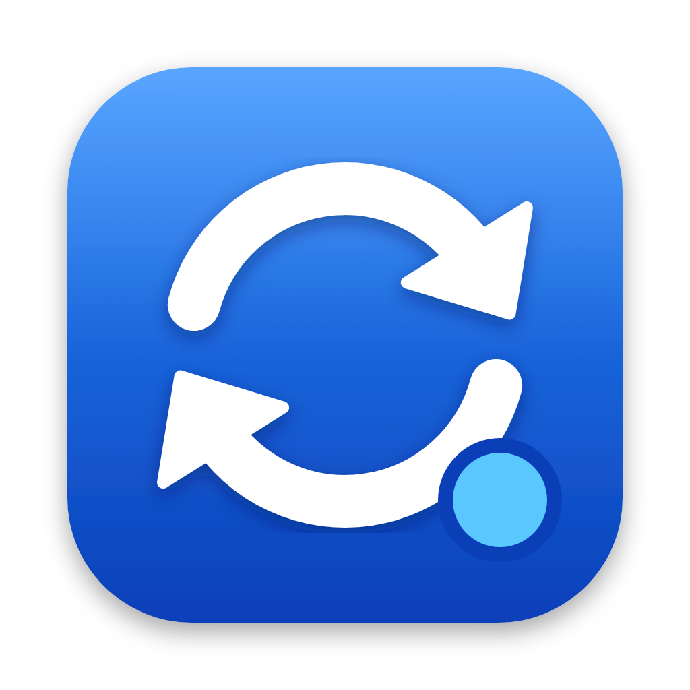
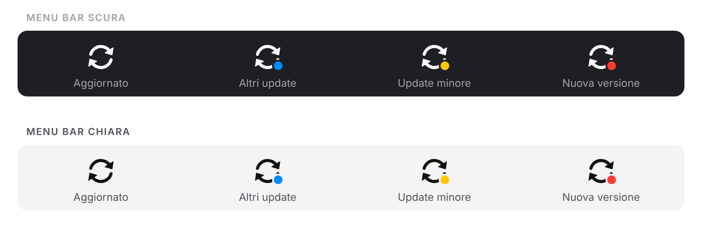

<div align="center">



# UpdateBar

**macOS updates at a glance. Windows Update style, for your Mac.**

A tiny menu bar app that checks for system updates<br>
and shows them with two arrows and a colored dot.

[](#requirements)
[](UpdateBar.swift)
[](LICENSE)
[](https://github.com/AndreaPolazzo/UpdateBar/releases/latest)

[Website](https://andreapolazzo.github.io/UpdateBar/) · [Features](#-features) · [Install](#-install) · [How it works](#%EF%B8%8F-how-it-works) · [FAQ](#-faq) · [Roadmap](#%EF%B8%8F-roadmap)

</div>

---

## ✨ Why

On Windows you always know when an update is waiting: a small icon in the taskbar tells you, without getting in the way.
On macOS the red badge is buried inside System Settings, where nobody looks.

**UpdateBar** brings that indicator to the Mac menu bar, and adds one more piece of information: **what kind** of update is waiting for you.

<div align="center">

</div>

## 🎨 Colors

| Icon | Meaning | Example |
|:---:|---|---|
| ⚪️ no dot | You're up to date | — |
| 🔵 blue | Other updates | Command Line Tools, Safari, Rapid Security Responses |
| 🟡 yellow | Minor macOS update | 27.1 → 27.2 |
| 🔴 red | Major macOS upgrade | 26 → 27 |

When several updates are available, the dot shows **the most important one**.
While a check is running, the arrows are dimmed.

## 🚀 Features

- **Automatic checks** at launch and every 4 hours
- **Check now** from the menu, or with <kbd>⌘</kbd> <kbd>R</kbd>
- **Native macOS notifications**, sent only once per new update
- **List of available updates**, flagged when a restart is required
- **One click** on an update opens *System Settings → Software Update*
- **Launch at login** toggle (uses `SMAppService`, no hand-written LaunchAgents)
- **No Dock icon**: it lives in the menu bar only
- **Follows** light and dark menu bars automatically
- **Zero dependencies**: a single Swift file, builds without Xcode

## 📦 Install

### Download (recommended)

1. Download **[`UpdateBar.dmg`](https://github.com/AndreaPolazzo/UpdateBar/releases/latest/download/UpdateBar.dmg)** from the latest [Release](https://github.com/AndreaPolazzo/UpdateBar/releases/latest)
2. Open it and drag **UpdateBar** onto the **Applications** folder
3. Launch it. The first time, macOS blocks it because it isn't signed with an Apple Developer ID:
   go to **System Settings → Privacy & Security** and click **Open Anyway**

> [!NOTE]
> Alternatively, from Terminal: `xattr -dr com.apple.quarantine /Applications/UpdateBar.app`

Runs on both Apple Silicon and Intel Macs (universal binary). A `UpdateBar.zip` is also attached to every Release if you prefer it.

### Build from source

All you need is a Mac with the **Command Line Tools** (no Xcode):

```bash
xcode-select --install
git clone https://github.com/AndreaPolazzo/UpdateBar.git
cd UpdateBar
./build.sh
```

The script compiles, ad-hoc signs, installs the app into `/Applications` and launches it.
After that, the cloned folder is no longer needed.

> [!TIP]
> Open the UpdateBar menu and turn on **Launch at login** to keep it always running.

### Updating

Download the latest Release, or from source: `git pull && ./build.sh`

### Uninstalling

1. UpdateBar menu → turn off **Launch at login** → **Quit**
2. Drag `/Applications/UpdateBar.app` to the Trash

### Requirements

- macOS 13 Ventura or later
- Apple Silicon or Intel

## ⚙️ How it works

UpdateBar uses no private APIs and no external services. Under the hood:

```
                 every 4 hours / ⌘R
                        │
                        ▼
        /usr/sbin/softwareupdate --list
                        │
                        ▼
     parse "Label" + "Title, Version, Action"
                        │
                        ▼
  ┌─────────────────────┼──────────────────────┐
  │                     │                      │
 not macOS      macOS, same major      macOS, major > current
  🔵 blue           🟡 yellow                🔴 red
```

- The current version is read from `ProcessInfo.operatingSystemVersion`
- The icon is drawn at runtime from the SF Symbol `arrow.triangle.2.circlepath`, tinted with `labelColor` so it matches the menu bar theme
- The dot has a transparent ring around it, just like the Windows indicator

### Project structure

```
UpdateBar/
├── UpdateBar.swift   # the whole app: model, checker, icon, menu
├── Info.plist        # LSUIElement = no Dock icon
├── AppIcon.icns      # app icon
├── build.sh          # build, sign, install, launch (--ci: create DMG and zip)
├── .github/workflows # automated builds and Releases
└── assets/           # README images
```

### Releases

Every push to `main` builds the app on a GitHub-hosted Mac and publishes the Release `v<version>` with the DMG and the zip.
To ship a new version, bump `CFBundleShortVersionString` in `Info.plist`.

## ❓ FAQ

<details>
<summary><b>Why isn't it on the App Store?</b></summary>
<br>
To read available updates it has to run <code>softwareupdate</code>, which the App Store sandbox doesn't allow.
</details>

<details>
<summary><b>Does it install updates by itself?</b></summary>
<br>
No, on purpose. Installing system updates requires administrator privileges: UpdateBar only lets you know and opens Software Update.
</details>

<details>
<summary><b>The first check is slow</b></summary>
<br>
That's expected: <code>softwareupdate --list</code> talks to Apple's servers and can take 20–60 seconds. The arrows stay dimmed in the meantime.
</details>

<details>
<summary><b>I don't see the red dot even though a new macOS version is out</b></summary>
<br>
On some Macs (managed by an organization, or with deferred updates) <code>softwareupdate</code> doesn't list major upgrades, so UpdateBar can't see them either.
</details>

<details>
<summary><b>macOS says the app can't be opened</b></summary>
<br>
The downloaded build isn't signed with an Apple Developer ID (that costs $99/year). Go to <b>System Settings → Privacy & Security → Open Anyway</b>, or remove the quarantine flag with <code>xattr -dr com.apple.quarantine /Applications/UpdateBar.app</code>. Building it yourself with <code>build.sh</code> avoids this.
</details>

<details>
<summary><b>Build error about <code>@State</code> / <code>SwiftUIMacros</code></b></summary>
<br>
The Command Line Tools alone don't ship the SwiftUI macro plugin. UpdateBar is written without macros on purpose, so if you see this error you're building a modified version.
</details>

## 🗺️ Roadmap

- [x] Prebuilt Releases (DMG, universal binary)
- [ ] Homebrew updates (`brew outdated`)
- [ ] App Store updates (`mas outdated`)
- [ ] Configurable check interval
- [ ] English localization of the app UI
- [ ] Developer ID signing and notarization
- [x] [Website](https://andreapolazzo.github.io/UpdateBar/)

## 🤝 Contributing

Issues and pull requests are welcome. For bigger changes, please open an issue first to discuss it.

1. Fork the project
2. Create a branch: `git checkout -b feature/my-feature`
3. Commit: `git commit -m "Add my-feature"`
4. Push: `git push origin feature/my-feature`
5. Open a Pull Request

## 📄 License

Distributed under the MIT License. See [`LICENSE`](LICENSE).

---

<div align="center">

Made with ☕ by [**Andrea Polazzo**](https://andreapolazzo.com)

If you find it useful, leave a ⭐

</div>
